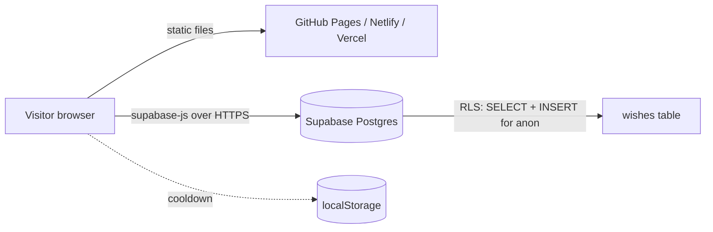

<div align="center">

# 🎂 Ananna Birthday Experience

**A zero-build, single-page birthday site with a live, database-backed wish wall.**
Wishes submitted by visitors are stored in Supabase and drift up the screen as floating notes in real time.


[Features](#-features) · [Quick start](#-quick-start) · [Supabase setup](#-supabase-setup) · [Deploy](#-deployment) · [Customize](#-customization) · [Security](#-security-model) · [Troubleshooting](#-troubleshooting)

</div>

---

## ✨ Features

| Area | What you get |
|---|---|
| **Design** | Dark navy canvas with layered radial lighting, glassmorphism panels, drifting orbs, fluid `clamp()` typography |
| **Wish wall** | Public form → Supabase `INSERT`; wall loads the 50 oldest wishes; new ones appear instantly |
| **Floating wishes** | Submitted messages float up behind the page (max 12 on screen, auto-cleaned on `animationend`) |
| **Music** | Background track with autoplay attempt + graceful fallback to first user gesture |
| **Responsive** | Mobile-first grid collapse at 700px, safe nav pill, `100svh` hero |
| **Accessible** | Semantic landmarks, labelled form, `aria-live` status, `prefers-reduced-motion` respected |
| **Safe rendering** | All visitor text is written with `textContent` (no HTML injection / XSS) |
| **Spam friction** | Client 30 s cooldown + DB-enforced length checks + optional DB throttle trigger |
| **Resilient** | Missing/invalid Supabase config shows a friendly message; the rest of the site still works |
| **Zero tooling** | No bundler, no npm install, no framework: open `index.html` and go |

## 🧱 Architecture



**Data flow:** `app.js` reads `window.APP_CONFIG` → creates a Supabase client with the *publishable* key → `loadWishes()` fetches rows → each row becomes a wall card and (last 6) a floating bubble. On submit: validate → cooldown check → `insert` → optimistic UI update.

## 📁 Project structure

```text
ananna-birthday/
├── index.html                # Markup + SEO/OpenGraph meta
├── css/
│   └── style.css             # All styling, design tokens in :root
├── js/
│   ├── app.js                # Wish wall, floating wishes, audio, cooldown
│   ├── config.js             # Supabase URL + publishable key (public by design)
│   └── config.example.js     # Template for new deployments
├── assets/
│   └── audio/birthday-song.mp3
├── supabase/
│   └── schema.sql            # Table + RLS policies (+ optional throttle trigger)
├── .nojekyll                 # Tells GitHub Pages to serve files as-is
├── .gitignore
├── LICENSE
└── README.md
```

## 🚀 Quick start

```bash
git clone https://github.com/YOUR_USERNAME/ananna-birthday.git
cd ananna-birthday

# any static server works; pick one:
python3 -m http.server 8080        # → http://localhost:8080
# npx serve .
```

> Opening `index.html` directly with `file://` also works, but a local server matches production behavior (and audio autoplay rules) more closely.

## 🗄️ Supabase setup

1. Create a free project at [supabase.com](https://supabase.com).
2. Open **SQL Editor → New query**, paste the contents of [`supabase/schema.sql`](supabase/schema.sql), and run it. The script is idempotent (safe to re-run).
3. Open **Project Settings → API** and copy the **Project URL** and the **publishable (anon) key**.
4. Put them in `js/config.js`:

```js
window.APP_CONFIG = {
  SUPABASE_URL: "https://YOUR_PROJECT_REF.supabase.co",
  SUPABASE_PUBLISHABLE_KEY: "YOUR_SUPABASE_PUBLISHABLE_KEY",
};
```

### Table contract

| Column | Type | Constraint |
|---|---|---|
| `id` | `bigint` identity | primary key |
| `sender` | `text` | not null, 1–40 chars |
| `message` | `text` | not null, 1–240 chars |
| `created_at` | `timestamptz` | default `now()` |

## 🌍 Deployment

<details>
<summary><b>GitHub Pages</b> (recommended, free)</summary>

1. Push the repo to GitHub.
2. **Settings → Pages → Build and deployment → Deploy from a branch → `main` / `(root)`**.
3. Your site goes live at `https://YOUR_USERNAME.github.io/ananna-birthday/`.

</details>

<details>
<summary><b>Netlify</b></summary>

Drag the project folder onto [app.netlify.com/drop](https://app.netlify.com/drop), or connect the repo with **no build command** and publish directory `.`.

</details>

<details>
<summary><b>Vercel</b></summary>

Import the repo, set **Framework Preset: Other**, leave build/output settings empty.

</details>

Free tiers have usage limits; check each provider's current terms before sharing widely.

## 🎨 Customization

| Want to change | Where |
|---|---|
| Colors | CSS variables at the top of `css/style.css` (`--navy`, `--yellow`, `--blue`, `--red`, `--pink`, `--white`) |
| Names & copy | Text in `index.html` (hero, About, birthday note, footer) |
| Monogram | `<div class="initials">AB</div>` in the About section |
| Music | Replace `assets/audio/birthday-song.mp3` (keep the filename or update the `<audio src>`) |
| Cooldown | `COOLDOWN_MS` in `js/app.js` |
| Wall size / bubbles | `.limit(50)` in `loadWishes()` and `MAX_FLOATING_WISHES` |
| Message length | Update `maxlength` in HTML, the checks in `app.js`, **and** the SQL constraints |

## 🔒 Security model

- The **publishable key is meant for browsers.** Real protection comes from **Row Level Security**, which must stay enabled.
- Policies allow only `SELECT` and `INSERT` for `anon`. With no `UPDATE`/`DELETE` policies, those operations are denied.
- Length limits are enforced **in the database**, not just in the browser.
- Visitor content is rendered via `textContent`, so markup in a message is displayed as plain text.
- **Never** commit a `service_role` key, secret key, or database password.
- Because anyone can insert, a determined spammer can still flood the table. Mitigations: enable the optional throttle trigger in `schema.sql`, add CAPTCHA (e.g. Cloudflare Turnstile) via an Edge Function, and delete abusive rows from the Supabase dashboard (**Table Editor**).

## 🛠 Troubleshooting

| Symptom | Likely cause / fix |
|---|---|
| "Wish wall is not configured yet" | `js/config.js` still has placeholder values |
| "Birthday wishes are temporarily unavailable" | Table missing, wrong name, or no `SELECT` policy; re-run `schema.sql` and check the browser console |
| "Your wish could not be sent" | No `INSERT` policy, or text violates length limits |
| `policy already exists` error | You ran an older script; the current `schema.sql` drops and recreates policies |
| No music | Browsers block autoplay until interaction; click anywhere once. Also check the file path |
| Works locally, not on Pages | Make sure `.nojekyll` is committed and paths are relative |

## 🗺 Roadmap

- [ ] Realtime updates via Supabase Realtime channels
- [ ] Pagination / "load more" for large walls
- [ ] CAPTCHA-protected submission through an Edge Function
- [ ] Mute/volume control for the soundtrack
- [ ] Config-driven recipient name and copy

## 📄 License

Code is released under the [MIT License](LICENSE). The bundled audio file is **not** covered by it; use music you have permission to distribute.

<div align="center">

Made with ♡ by [Risat](https://www.instagram.com/matrix_risat/)

</div>
